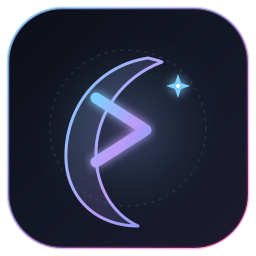
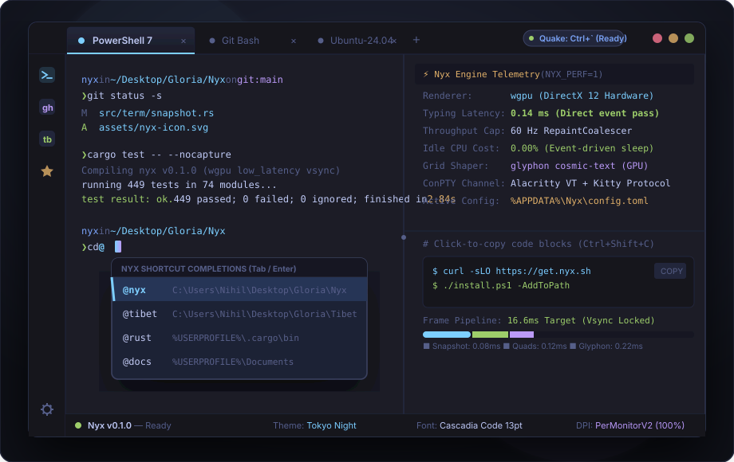
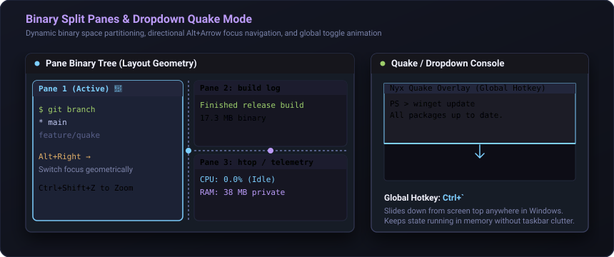
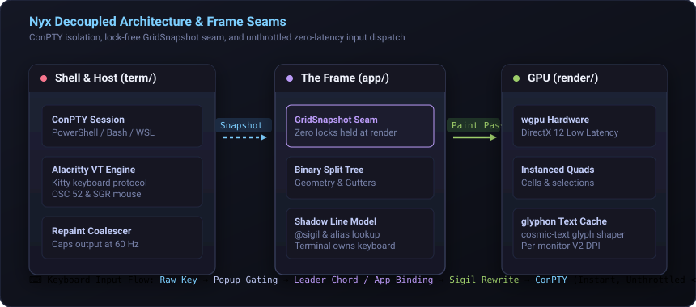

<div align="center">



# Nyx

**An ultra-low latency, GPU-accelerated terminal emulator crafted for Windows**

*Forged in pure Rust with wgpu, cosmic-text, binary split panes, and zero-overhead ConPTY integration.*

<p>
  <a href="LICENSE"></a>
  
  
  
  
  
  
  
</p>

---

<p>
  <a href="#-about-nyx">About</a> •
  <a href="#-key-features">Features</a> •
  <a href="#-visual-tour">Visual Tour</a> •
  <a href="#-architecture--performance">Architecture</a> •
  <a href="#-installation--usage">Installation</a> •
  <a href="#-keyboard-shortcuts">Shortcuts</a> •
  <a href="#-configuration--customization">Configuration</a> •
  <a href="#-building-from-source">Building</a> •
  <a href="#-icon--design-philosophy">Design</a> •
  <a href="#-upstream--license">License</a>
</p>

<picture>
  <source srcset="assets/nyx-interface-preview.svg" media="(prefers-color-scheme: dark)" />
  
</picture>

</div>

---

## 🌌 About Nyx

In Greek mythology, **Nyx** (Νύξ) is the primordial goddess of the night — shadowy, swift, and celestial. She commands the dark heavens with quiet power and effortless grace.

Modern Windows terminal emulators often make a frustrating compromise: they are either sluggish webview/Electron wrappers that consume hundreds of megabytes of RAM at idle, or dated legacy shells lacking modern GPU acceleration, split panes, and shell integration.

**Nyx** is a standalone, high-performance terminal emulator designed from the metal up exclusively for Windows. Built in pure Rust without an async runtime, webview, or Node runtime, Nyx focuses on what matters most in a command line: **uncompromising input latency, fluid GPU rendering, and zero idle cost**.

- ⚡ **Zero-Latency Keyboard Pipeline**: Keystrokes reach the ConPTY process immediately without queuing or timer throttling (&lt;0.2 ms measured dispatch).
- 🎮 **Hardware GPU Acceleration**: Direct rendering with `wgpu` (DirectX 12 backend), instanced background cell quads, and sub-pixel text shaping via `glyphon` / `cosmic-text`.
- 🪟 **First-Class Windows Platform Integration**: Native PerMonitorV2 DPI awareness, long path support (`\\?\`), single-instance IPC, Quake-style dropdown hotkey, and Explorer `"Open Nyx here"` context integration.
- 🌳 **Binary Tree Split Panes**: Freely split any pane horizontally or vertically with draggable gutters, directional `Alt+Arrow` geometric focus, and pane zoom.
- 🔮 **Prompt Sigil & Prefix Expansion**: Fast path jumping (`cd @shortcut`), command aliases, and tmux-style leader chords with live popup completion.
- 🛡️ **100% Local & Privacy Conscious**: No telemetry, no background update daemons, no analytics pings. Settings live cleanly in `%APPDATA%\Nyx`.

---

## ✨ Key Features

<table>
  <tr>
    <td width="50%">
      <h3>🚀 GPU-Accelerated Text &amp; Grid</h3>
      <p>DirectX 12 rendering via <code>wgpu</code> with low-latency vsync. Glyph shaping and caching powered by <code>glyphon</code> (cosmic-text) with per-monitor DPI scaling.</p>
    </td>
    <td width="50%">
      <h3>🪟 Binary Space Split Panes</h3>
      <p>Organize workspaces with arbitrary horizontal and vertical splits. Navigate panes geometrically via <code>Alt+Arrow</code>, drag borders, and zoom with <code>Ctrl+Shift+Z</code>.</p>
    </td>
  </tr>
  <tr>
    <td width="50%">
      <h3>⚡ 4-Tier Sigil &amp; Prefix Engine</h3>
      <p>Four distinct expansion modes: shell-integrated path sigils (<code>cd @docs</code>), command aliases, terminal-side leader chords, and wrapper prefixes.</p>
    </td>
    <td width="50%">
      <h3>🕹️ Quake Dropdown Console</h3>
      <p>Summon a dropdown terminal from the top of the monitor anywhere in Windows with a global hotkey (<code>Ctrl+`</code>), keeping persistent sessions without taskbar clutter.</p>
    </td>
  </tr>
  <tr>
    <td width="50%">
      <h3>🎨 Custom Shortcut Rail &amp; Shell Icons</h3>
      <p>A sleek left sidebar populated with your favorite directories and tools. Supports vector built-ins (<code>builtin:</code>), image files (<code>file:</code>), and Win32 icon extraction (<code>exe:</code>).</p>
    </td>
    <td width="50%">
      <h3>⚙️ Live GUI with Comment-Preserving TOML</h3>
      <p>Edit preferences visually with <code>Ctrl+,</code>. Modifying themes, fonts, or keybinds preserves all hand-written comments in <code>config.toml</code> using <code>toml_edit</code>.</p>
    </td>
  </tr>
  <tr>
    <td width="50%">
      <h3>🔍 High-Speed Scrollback Search</h3>
      <p>Search up to 10,000 lines of scrollback buffer instantly with regex support (<code>Ctrl+Shift+F</code>), live result counts, and matched-term highlighting.</p>
    </td>
    <td width="50%">
      <h3>📋 Click-to-Copy Blocks &amp; OSC 52</h3>
      <p>Smart detection of code blocks with click-to-copy buttons, bi-directional clipboard access via OSC 52, Kitty keyboard protocol, and SGR mouse tracking.</p>
    </td>
  </tr>
</table>

---

## 📸 Visual Tour

### 1. Binary Split Panes &amp; Dropdown Quake Mode
Split your active terminal into multiple concurrent sessions, adjust splits with draggable dividers, and navigate between panes geometrically. Press `Ctrl+` ` to toggle Nyx instantly as a system-wide dropdown overlay.

<p align="center">
  
</p>

### 2. Prompt Sigil (`@`) Autocompletion Menu
Type `@` at any shell prompt to invoke Nyx's intelligent overlay completion menu. Press <kbd>Tab</kbd> to autocomplete directory paths, or press <kbd>Enter</kbd> on a bare sigil to open a new tab immediately pinned to that workspace.

```powershell
# Typing '@' displays the completion dropdown anchored at your cursor:
PS C:\Users\Nihil> cd @
┌────────────────────────────────────────────────────────┐
│  NYX SHORTCUT COMPLETIONS (Tab / Enter)                │
├────────────────────────────────────────────────────────┤
│  ▶ @nyx      C:\Users\Nihil\Projects\Nyx               │
│    @gloria   C:\Users\Nihil\Desktop\Gloria Repoz        │
│    @rust     C:\Users\Nihil\.cargo\bin                 │
│    @docs     C:\Users\Nihil\Documents                  │
└────────────────────────────────────────────────────────┘
```

### 3. Comment-Preserving Live Settings GUI
Press `Ctrl+,` to open the built-in configuration dashboard. Select system fonts, adjust font sizes, swap color themes (Tokyo Night, Claude Dark, Claude Light, Nord), and manage shell profiles with instant live preview.

---

## 🏗️ Architecture &amp; Performance

Nyx enforces strict architectural module boundaries to achieve predictable, ultra-low latency while maintaining zero idle cost:

<p align="center">
  
</p>

### The Two Core Seams

1. **`term::snapshot::GridSnapshot`**: The sole seam crossing from the terminal state into rendering. A clean owned data structure built under the `Term` lock and handed over to the GPU thread. **Zero locks are held during rendering**.
2. **`event::AppEvent`**: The bounded channel delivering external events (window activations, child exits, bells, clipboard sync, IPC requests, and global hotkeys) into the frame loop.

### Measured Performance Profile

| Metric | Measured Value | Architecture Cause |
|---|---|---|
| **Keystroke Latency** | **&lt; 0.20 ms** | Direct unthrottled event dispatch from OS window to ConPTY |
| **Idle CPU Utilization** | **0.00%** | Event-driven wait; wakeups occur solely on input or shell output |
| **Output Throttle Cap** | **60 Hz** | `RepaintCoalescer` decouples bursty shell output from GPU overdraw |
| **Binary Size** | **~17.3 MB** | Single standalone Rust binary; zero Chromium, webview, or Node dependencies |
| **DPI Scaling** | **PerMonitorV2** | Declared in `nyx.manifest` at PE creation; zero scale artifacts or runtime resize flicker |

---

## 🚀 Installation &amp; Usage

### Automated PowerShell Installer

Compile release binaries and run the user-scoped installer:

```powershell
# Build release binary (LTO optimized)
cargo build --release

# Install for current user (no admin rights required)
.\install.ps1 -AddToPath
```

The installer configures:
- Standalone executable copied to `%LOCALAPPDATA%\Programs\Nyx\nyx.exe`
- Start Menu shortcut with dedicated Windows icon
- Shell `PATH` environment variable registration
- Optional Windows Explorer right-click context menu: **"Open Nyx here"**

To safely uninstall Nyx:
```powershell
.\uninstall.ps1            # Keeps user settings
.\uninstall.ps1 -Purge     # Cleans %APPDATA%\Nyx configuration
```

### Command-Line Usage

```powershell
# Open terminal in current directory
nyx

# Open terminal in a specific directory
nyx -d "C:\Projects\Gloria"

# Attach to existing Nyx window as a new tab
nyx --attach

# Force a new standalone window
nyx --new-window

# Register / unregister Explorer context menu
nyx --install-context-menu
nyx --remove-context-menu
```

---

## ⌨️ Keyboard Shortcuts

Nyx adheres to a strict principle: **The terminal owns the keyboard**. Keystrokes are only intercepted when an active overlay demands them, ensuring native command-line interactions remain fully intact.

| Category | Shortcut | Action |
|---|---|---|
| **Split Panes** | <kbd>Ctrl</kbd> + <kbd>Shift</kbd> + <kbd>D</kbd> | Split pane vertically (right) |
| | <kbd>Ctrl</kbd> + <kbd>Shift</kbd> + <kbd>E</kbd> | Split pane horizontally (down) |
| | <kbd>Alt</kbd> + <kbd>←</kbd> <kbd>→</kbd> <kbd>↑</kbd> <kbd>↓</kbd> | Navigate pane focus geometrically |
| | <kbd>Ctrl</kbd> + <kbd>Shift</kbd> + <kbd>W</kbd> | Close focused pane |
| | <kbd>Ctrl</kbd> + <kbd>Shift</kbd> + <kbd>Z</kbd> | Toggle pane zoom (maximize / restore) |
| **Tabs** | <kbd>Ctrl</kbd> + <kbd>T</kbd> | Open new tab (default shell profile) |
| | <kbd>Ctrl</kbd> + <kbd>W</kbd> | Close active tab |
| | <kbd>Ctrl</kbd> + <kbd>Tab</kbd> | Cycle forward through tabs |
| | <kbd>Ctrl</kbd> + <kbd>Shift</kbd> + <kbd>Tab</kbd> | Cycle backward through tabs |
| | <kbd>Ctrl</kbd> + <kbd>1</kbd> .. <kbd>9</kbd> | Jump directly to tab index |
| **Search &amp; Buffer** | <kbd>Ctrl</kbd> + <kbd>Shift</kbd> + <kbd>F</kbd> | Open scrollback search bar |
| | <kbd>F3</kbd> / <kbd>Shift</kbd> + <kbd>F3</kbd> | Jump to next / previous search match |
| | <kbd>Shift</kbd> + <kbd>PageUp</kbd> / <kbd>PageDown</kbd> | Scroll history page up / down |
| **Interface &amp; Tools** | <kbd>Ctrl</kbd> + <kbd>`</kbd> | Toggle Quake dropdown console (system-wide) |
| | <kbd>Ctrl</kbd> + <kbd>P</kbd> | Open fuzzy command palette |
| | <kbd>Ctrl</kbd> + <kbd>,</kbd> | Open Settings GUI |
| | <kbd>Ctrl</kbd> + <kbd>+</kbd> / <kbd>-</kbd> / <kbd>0</kbd> | Increase / decrease / reset font size |
| | <kbd>Ctrl</kbd> + <kbd>Shift</kbd> + <kbd>C</kbd> | Copy selected text |
| | <kbd>Ctrl</kbd> + <kbd>Shift</kbd> + <kbd>V</kbd> | Paste from clipboard |

---

## ⚙️ Configuration &amp; Customization

Nyx stores its primary configuration at:
```
%APPDATA%\Nyx\config.toml
```

Any modification to `config.toml` is **hot-reloaded instantly** on file save without restarting the application.

```toml
[window]
width = 1200.0
height = 760.0
opacity = 0.98
single_instance = true

[font]
family = "Cascadia Code"
size = 13.0
line_height = 1.2

[theme]
preset = "Tokyo Night"   # "Tokyo Night" | "Claude Dark" | "Claude Light" | "Nord"

[expand]
completion = true        # Floating @completion menu
hint = true              # Inline cursor ghost hints

# Custom Shortcut Rail Icons: builtin, file, or exe
[[shortcuts]]
sigil = "@nyx"
label = "Nyx Terminal"
path = "C:\\Users\\Nihil\\Projects\\Nyx"
icon = "builtin:terminal"

[[shortcuts]]
sigil = "@docs"
label = "Documents"
path = "C:\\Users\\Nihil\\Documents"
icon = "builtin:folder"

[[shortcuts]]
sigil = "@editor"
label = "VS Code"
path = "C:\\Program Files\\Microsoft VS Code"
icon = "exe:C:\\Program Files\\Microsoft VS Code\\Code.exe"
```

---

## 🛠️ Building from Source

### Prerequisites

- **Windows 10 (Version 1809+) or Windows 11**
- **Rust Toolchain**: Stable MSVC toolchain (`rustup default stable-x86_64-pc-windows-msvc`)
- **Git for Windows**

### Build Commands

```powershell
# 1. Clone the repository
git clone https://github.com/projectGloria/Nyx.git
cd Nyx

# 2. Fast syntax & type check
cargo check

# 3. Run the comprehensive test suite (449 tests)
cargo test -- --nocapture

# 4. Compile optimized release binary
cargo build --release
```

The resulting optimized executable will be located at:
```
target\release\nyx.exe
```

### Developer Diagnostics & Switches

- `NYX_PERF=1`: Enables the in-frame telemetry overlay displaying snapshot timings, quad generation, and glyphon text shaping costs in microseconds.
- `NYX_BARE=1`: Boots an empty `eframe` window without terminal instances to accurately attribute graphics memory overhead.
- `WGPU_BACKEND=dx12`: Forces DirectX 12 hardware acceleration (or set `vulkan` / `gl` for debugging).

---

## 🎨 Icon &amp; Design Philosophy

<p align="center">
  
</p>

> *"A midnight celestial crescent embracing the swift command prompt chevron, illuminated by neon starlight against deep cosmic obsidian."*

The visual identity of Nyx reflects its core technical goals:
- **Cosmic Obsidian Base**: Evokes the nocturnal realm of goddess Nyx, grounding the terminal with a deep, low-eye-strain canvas.
- **Electric Cyan &amp; Neon Violet**: High-contrast accents inspired by the Tokyo Night palette, offering instant visual feedback for active panes, cursor states, and sigil menus.
- **Terminal Chevron &amp; Star Spark**: Represents raw command execution speed, precision, and zero-latency responsiveness across all Windows DPI scale factors (100% to 250%).

---

## 📜 Upstream &amp; License

Nyx is distributed under the **[ISC License](LICENSE)**.

### Core Dependencies &amp; Acknowledgments
- **[Alacritty Terminal](https://github.com/alacritty/alacritty)**: Battle-tested VT parsing and terminal grid primitives.
- **[wgpu](https://github.com/gfx-rs/wgpu)**: Safe, portable GPU rendering abstraction targeting DirectX 12.
- **[glyphon](https://github.com/grovesNL/glyphon) &amp; cosmic-text**: Advanced GPU-accelerated text layout and glyph caching.
- **[eframe &amp; egui](https://github.com/emilk/egui)**: Immediate-mode GUI framework powering the native chrome and settings window.
- **Windows ConPTY**: High-performance native pseudo-console subsystem provided by Microsoft Windows.
